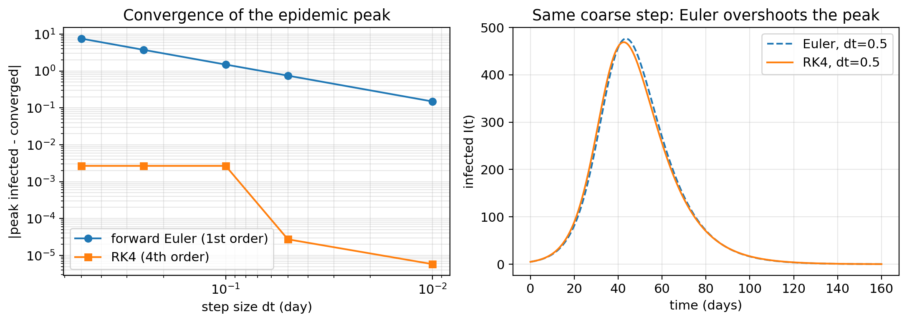
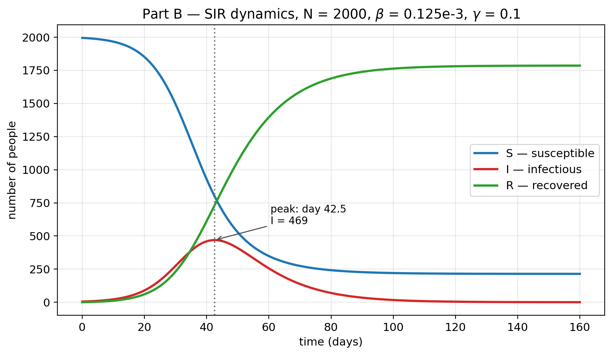
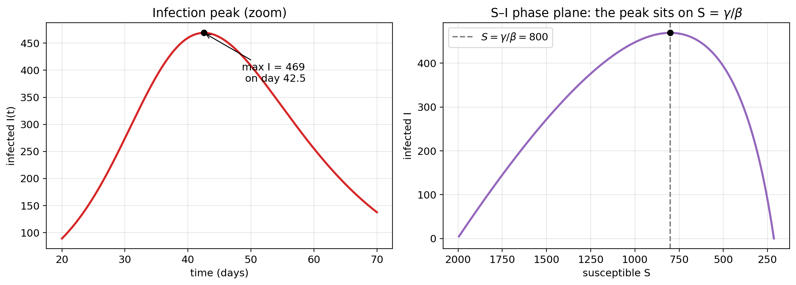
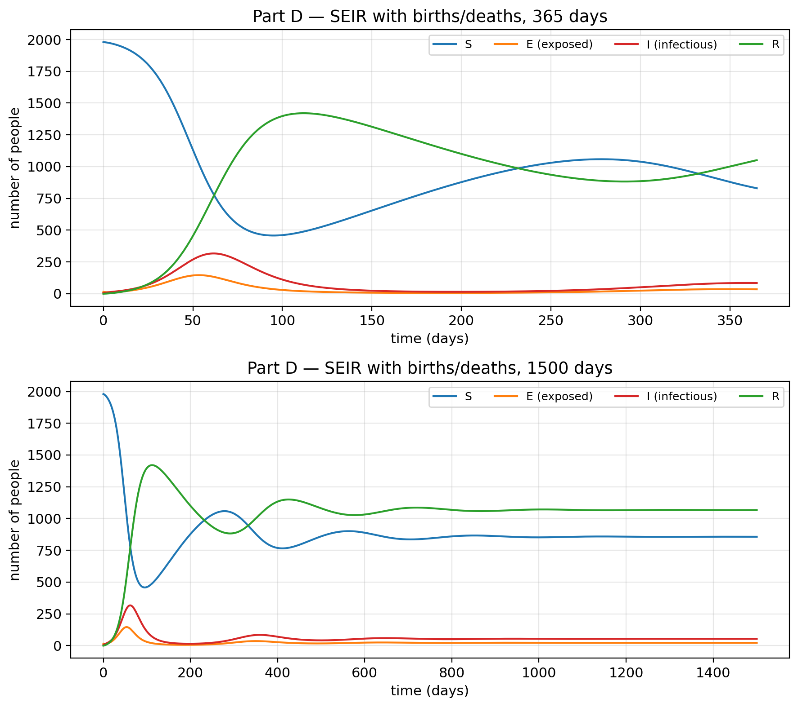
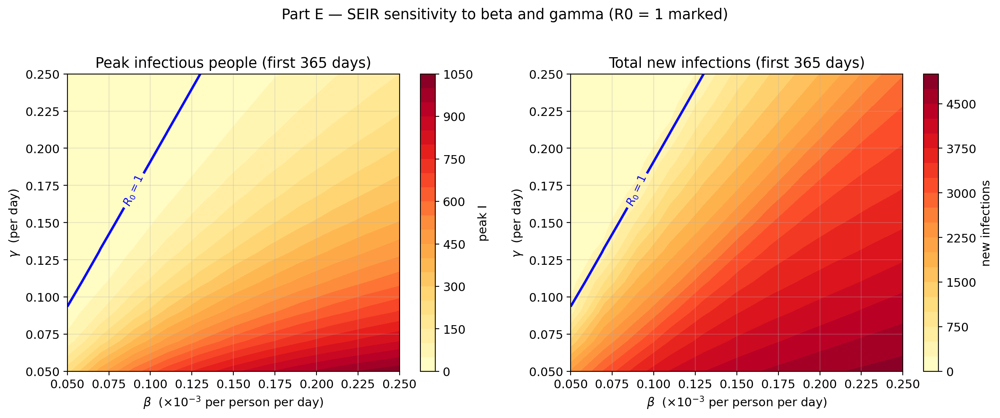

# BMI500-HW7

- **Name:** Heng Sun (Jimmy)
- **Email:** heng.sun@emory.edu
- **Question:** HW 1 — SIR and SEIR Model Implementation for Pandemic Spread

---

## 1. How to run

```bash
# 1. create an environment
python -m venv .venv
# Windows:  .venv\Scripts\activate        Linux/macOS:  source .venv/bin/activate
pip install -r requirements.txt

# 2. run the notebooks in order A -> E
jupyter notebook            # then open partA/…, partB/…, and run all cells
```

Each notebook is self-contained: it locates the repository root automatically, imports the shared
solver from `epidemic_models.py`, and writes its figure(s) into `figures/`. The notebooks are
committed **with their outputs**, so the results can also be read without re-running anything.

---

## 2. Part A — Implementation and verification

The two models and the two integrators are located in `epidemic_models.py`. The integrators are classical forward Euler and classical

4th-order Runge–Kutta, both written out explicitly in `epidemic_models.py`.



---

## 3. Part B — SIR simulation



---

## 4. Part C — Analysis and interpretation



**(i) Infection peak.** $I(t)$ reaches its maximum of about **469 people on day 42.5**. The peak is
set by two competing effects: the supply of new infections, proportional to $\beta S I$, and the
removal of infectious people, proportional to $\gamma I$. They balance exactly when $S=\gamma/\beta$.
Because $\gamma/\beta = 800$ is far below $S(0)=1995$, the epidemic has a long runway and a large peak;
a larger $\beta$ raises the peak (and brings it earlier), while a larger $\gamma$ both lowers the peak
and shortens the outbreak. The height of the peak also depends on how long the system lingers near
$S=\gamma/\beta$, which is why $S(0)$ and $N$ matter too.

**(ii) Basic reproduction number.** $R_0=\beta N/\gamma = (0.125\times10^{-3})(2000)/0.1 = 2.5$.
This means that, in a fully susceptible population, each infectious person generates on average 2.5
secondary infections. Every primary case therefore replaces itself more than once, so the outbreak
grows. $R_0>1$ is the condition for an epidemic to take off; control measures must push $R_0$ below 1
(by reducing $\beta$, e.g. distancing/masks, or raising $\gamma$, e.g. faster detection and treatment),
and the _higher_ $R_0$ is, the larger the fraction of the population that must be immunized,
roughly $1-1/R_0 = 60\%$ here, to reach herd immunity.

**(iii) Epidemic dynamics.** In the early phase $I$ grows nearly exponentially because $S\approx N$
so $dI/dt\approx(\beta N-\gamma)I$, i.e. growth rate $\gamma(R_0-1)$. As $S$ falls, the growth rate
decreases, and the epidemic peaks at $S=\gamma/\beta$. Afterwards $S$ keeps falling (more slowly) and
$R$ keeps rising until $I\to 0$ and the outbreak dies out, leaving a positive susceptible pool:
**about 214 people (10.7%) are never infected**, so the attack rate is about 89.3% ($R(160)=1786$).
This matches the classic final-size relation $1-z=e^{-R_0 z}$ (which gives $z=0.893$). The reason the
outbreak stops before everyone is infected is that recovered people no longer transmit; the effective
reproduction number $R_{\text{eff}}=R_0 S/N$ falls below 1 once $S<N/R_0 = 800$.

---

## 5. Part D — SEIR model with births and deaths



**(iii) Waves.** With births and deaths the outbreak is **not** a single event. The first wave peaks
at **day 61.6 with about 317 infectious people** (lower and later than the SIR peak of 469 on day 42.5,
because the latent compartment delays transmission). $I$ then falls to a trough of ~15 people around
day 197, and when the birth term has refilled the susceptible pool the infection breaks out again:
subsequent peaks of about **85 people (day 359)**, **60 people (day 648)** and **55 people (day 938)**,
separated by roughly **290 days**. So there is one large first wave followed by smaller, damped
recurrent waves; the 365-day window shows only the first wave and the start of the second, whereas
1500 days reveals the recurrent pattern.

**(iv) $R_0$ comparison.** For the SEIR model
$R_0=\frac{\beta N\sigma}{(\sigma+\mu)(\gamma+\mu)}=\frac{(0.125\times10^{-3})(2000)(0.25)}{(0.255)(0.105)}=2.33$,
slightly **below** the SIR value of 2.50. Two things reduce it: the latent period means an exposed
person is not yet infectious (a factor $\sigma/(\sigma+\mu)$), and the death term removes people from
each compartment (the $(\gamma+\mu)$ and $(\sigma+\mu)$ factors). Numerically, the mean susceptible
level over the last 200 days of the 1500-day run is **857**, in excellent agreement with
$N/R_0=2000/2.33=857$. This number is the **endemic susceptible level**: with births continuously
adding new susceptibles, the population settles into a state where $S=N/R_0$ exactly, so that the
effective reproduction number $R_{\text{eff}}=R_0 S/N=1$ and each infection is replaced by precisely
one new infection — the infection persists indefinitely instead of dying out.

**(v) Effect of the exposed compartment and of births/deaths.** The exposed compartment acts as a
delay: with the same transmission parameters the SEIR peak (317, day 61.6) is smaller and later than
the SIR peak (469, day 42.4). Slowing transmission through a latent stage therefore flattens the
curve — which is exactly the public-health argument for "flattening the peak." Births and deaths are
what make the waves recur: with $\mu=0$ the SEIR model gives a single wave that dies out (final
$S\approx212$ and $I\to0$), whereas $\mu=0.005$ keeps replenishing susceptibles and produces damped
oscillations forever. The chosen $\mu=0.005\,\text{day}^{-1}$ is unrealistically large — it corresponds
to an average lifespan of only 200 days — and is deliberately inflated so that the slow demographic
oscillation is visible within a short simulation. With a realistic human lifespan ($\mu\sim1/70\,\text{yr}\approx4\times10^{-5}\,\text{day}^{-1}$)
the same phenomenon would appear but the inter-wave period would be of the order of the generation
time of the infection multiplied by the demographic turnover — i.e. many years to decades rather than
~290 days — so over a realistic horizon the epidemic would look like a single outbreak rather than a
rapidly repeating series of waves.

---

## 6. Part E — Sensitivity analysis



**(part4) Variables effects.** Both the peak and the total number of new infections rise with $\beta$ and fall with
$\gamma$, and to first order they depend on $R_0$, that is, on the ratio $\beta/\gamma$. The
$R_0=1$ curve separates two regimes: a large first wave above it (peak up to 1036 people and up to
4866 new infections in a year), and a sub-critical outbreak below it that simply decays from the
initial 5 infectious people (peaks of 8–12).

One detail is worth reporting. $\gamma$ has slightly more influence on the peak than $\beta$: the
elasticity is $-1.84$ for $\gamma$ versus $+1.58$ for $\beta$, even though the two are almost
symmetric in $R_0$ ($+1.00$ and $-0.95$). One possible explanation is that $\gamma$ also sets how
fast infectious people are removed, so it acts through two channels, while $\beta$ acts mainly
through $R_0$. The iso-$R_0$ control supports this: holding $R_0$ fixed at 2.33 while raising
$\gamma$ from 0.05 to 0.25 still lowers the peak from 387 to 216 people.

**(iii) Discussion.** $\beta$ combines contact rate and per-contact transmission, so it is the
parameter that social distancing, masking and vaccination act on. $\gamma$ is set by the biology of
the pathogen, so it can only be changed indirectly, through treatment, antivirals and faster case
detection. In practice $\beta$-type measures are the ones that can be pushed far enough to bring
$R_0$ below 1, and this matters because the transition around $R_0=1$ is steep: moving below the
line removes the wave, whereas sliding along it does not.

---

## 7. Discussion — Hypothesis revisited

1. **Peak in Part B — predicted the peak is around day 40–50 with roughly 400–500 infected.**
   _Supported._ The simulated peak is 469 people on day 42.5.
2. **Part D — predicted several waves, because births continuously resupply susceptibles.**
   _Supported._ The first wave (day 61.6, 317 people) is followed by damped waves at ~290-day intervals.
3. **Part E — predicted that $\beta$ would move the peak more than $\gamma$.**
   _Rejected._ The elasticities are $+1.58$ for $\beta$ but $-1.84$ for $\gamma$ so $\gamma$ is slightly the stronger lever. Although both β and γ affect R₀, γ also controls how quickly people recover, so the epidemic peak was more sensitive to γ than to β.

---

## 8. AI statement

> Statement: **Deepseek** was used to complete this homework.
> The full chat is available at:
> 【WorkBuddy】实现 HW1 SIR 和 SEIR 模型代码
> https://workbuddy.link/p/WBN0VPCWFdUhy7Q9xLjuic?ext2=copy_link

<!-- TODO: replace [AI-TOOL-NAME] and [PUBLIC-URL(S)] with the real values, and make sure the link
     opens for anyone after signing out. If you in fact used no generative AI, replace this whole
     block with:
     "Statement: No generative AI (in any form) has been used to complete this homework." -->
